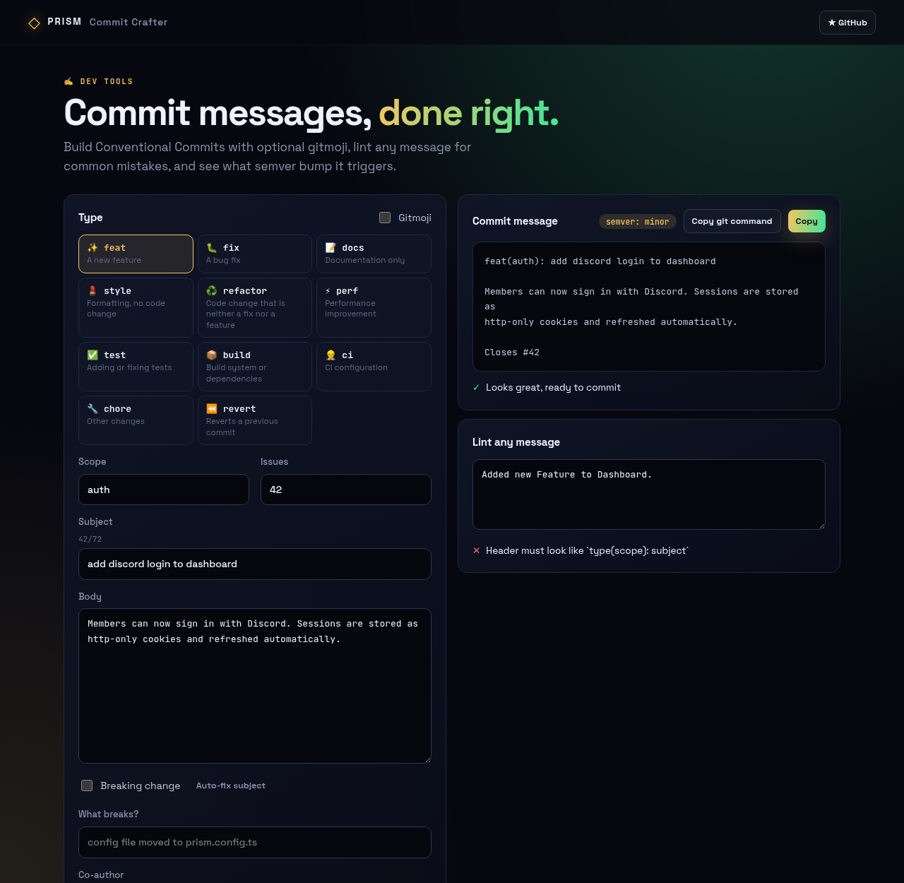
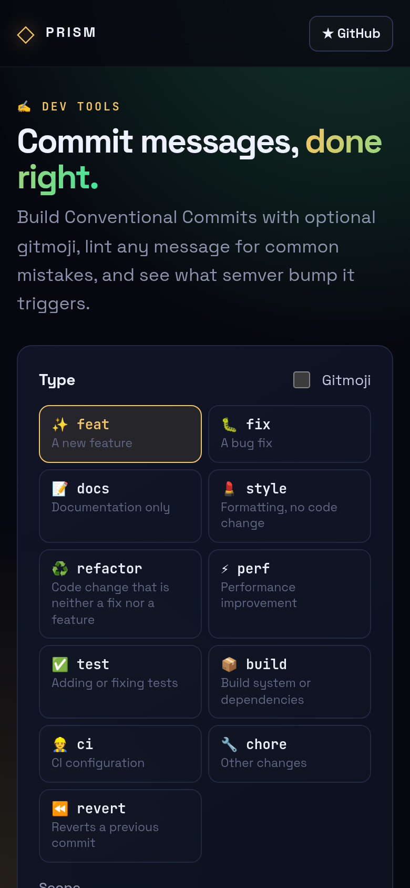

<!-- ═════════════ HEADER ═════════════ -->
<p align="center">
  
</p>

<p align="center">
  
</p>

<p align="center">
  <a href="https://github.com/krishyaa06/prism-commit-crafter/actions/workflows/ci.yml"></a>
  <a href="https://krishyaa06.github.io/prism-commit-crafter/"></a>
  
  
  <a href="LICENSE"></a>
</p>

<p align="center">
  
</p>


## ⚡ Overview

**Prism Commit Crafter** helps you and your team write consistent, meaningful commit history. Pick a type, add scope and subject, and it produces a properly formatted Conventional Commit with wrapped body and footers. The linter flags issues like past tense, trailing periods and long headers, and shows which semantic version bump the message implies.

## ✨ Features

- **11 commit types** with descriptions and optional **gitmoji**
- Scope, body (auto-wrapped at 72), **breaking change**, `Closes #` and `Co-authored-by` footers
- **Live linter**: format, length, imperative mood, casing, blank line
- **Semver bump** preview: major / minor / patch / none
- **Auto-fix** subject ("Added X." → "add X")
- Copy the message or a ready-to-run `git commit -m ... -m ...` command

## 📸 Screenshots

<table>
  <tr>
    <td width="68%"></td>
    <td width="32%"></td>
  </tr>
</table>

## 🚀 Quick Start

**Use it online:** [https://krishyaa06.github.io/prism-commit-crafter/](https://krishyaa06.github.io/prism-commit-crafter/)

**Run locally:**

```bash
git clone https://github.com/krishyaa06/prism-commit-crafter.git
cd prism-commit-crafter
# open index.html in your browser, or serve it:
npx serve .
```

## 🛠️ Usage

```text
feat(auth)!: add discord login to dashboard

Members can now sign in with Discord.

BREAKING CHANGE: old session cookies are invalidated
Closes #42
```

Paste any existing message into **Lint any message** to review it.

## 📁 Project Structure

```text
prism-commit-crafter/
├── assets/
│   ├── logo.png
│   └── logo.svg
├── css/
│   ├── app.css
│   └── prism.css
├── js/
│   ├── app.js   # UI wiring
│   ├── core.js   # builder, linter, semver logic — tested in Node
│   └── prism.js
├── test/
│   └── core.test.js
├── .gitignore
├── LICENSE
├── README.md
├── index.html
└── package.json
```

## 🧪 Tests

```bash
npm test
```

Tests use the built-in `node:test` runner, so there is nothing to install. CI runs them on Node 20 and 22.

## 🤝 Contributing

1. Fork the repo and create a branch: `git checkout -b feature/my-idea`
2. Make your change and add a test in `test/`
3. Run `npm test` and open a Pull Request

## 🔷 Part of Prism Protocol

Prism Commit Crafter is one of the open-source tools built by [Prism Protocol](https://dc.gg/prismprotocol), a tech community where young builders learn, ship and compete together.

## 👤 Author

<table>
  <tr>
    <td align="center">
      <a href="https://github.com/krishyaa06"><br><b>Soumya Bhandare</b></a><br>
      <sub>Founder @ Prism Protocol</sub>
    </td>
    <td>
      <a href="https://dc.gg/prismprotocol"></a><br>
      <a href="https://instagram.com/prism_protocol_"></a><br>
      <a href="https://x.com/krishyaa06"></a>
    </td>
  </tr>
</table>

## 📄 License

Released under the [MIT License](LICENSE).

<p align="center">
  <b>If you like this project, consider giving it a ⭐</b><br>
  <sub>"Build. Create. Compete." · Made with ⚡ by Prism Protocol</sub>
</p>


